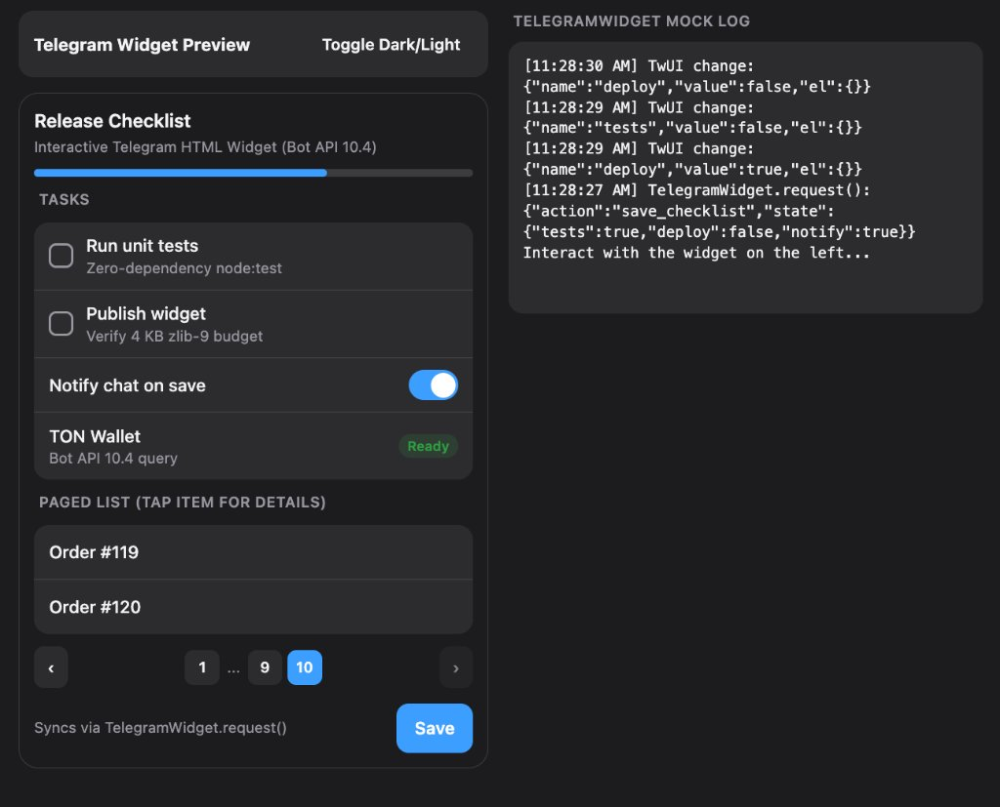

[English](README.md) | [Русский](README.ru.md)

# tg-widget-ui

[](LICENSE)
[](https://core.telegram.org/bots/api-changelog#november-9-2026)
[](package.json)
[](package.json)

Ультралёгкая UI-библиотека компонентов и сборщик HTML без зависимостей для **Telegram HTML Widgets** ([Telegram Bot API 10.4 от 9 ноября 2026](https://core.telegram.org/bots/api-changelog#november-9-2026)).

`#telegram` `#telegram-bot-api` `#telegram-widgets` `#html-widgets` `#bot-api-10-4` `#ui-library` `#quickjs` `#zero-dependency`



---

## Зачем нужен `tg-widget-ui`?

Telegram HTML-виджеты исполняются в строгой песочнице **QuickJS + DOM-шим** (Widget Profile 1) со следующими ограничениями:
- **Лимиты размера**: максимум **32 КБ** несжатого HTML и **4 КБ** после сжатия (`zlib` level 9).
- **Нет нативных форм**: теги `<input>`, `<select>` и `<textarea>` не поддерживаются.
- **Офлайн-песочница**: `fetch`, `XHR`, `WebSocket` и внешние CSS/JS/шрифты запрещены.
- **Нативная тема**: автоматическая адаптация через CSS-переменные `--tg-theme-*` и `light`/`dark` режимы.

`tg-widget-ui` предоставляет готовые доступные компоненты в стиле Telegram на базе `<button>` и ARIA-ролей (`role="checkbox"`, `role="switch"`, `role="radio"`), компактный рантайм с делегированием событий и компилятор `buildWidget()`, который минифицирует HTML и проверяет соответствие лимиту 4 КБ (`zlib-9`).

## Возможности

- **Популярные компоненты**: списки (`twList`), элементы списка (`twListItem`), кнопки (`twButton` — primary, secondary, outline, ghost, danger), кастомные чекбоксы (`twCheckbox` с поддержкой `indeterminate`), кнопка сохранения (`twSaveButton` со статусами dirty/saving/saved), переключатели (`twSwitch`), радиогруппы (`twRadioGroup`), бейджи (`twBadge`), прогресс-бар (`twProgress`), карточки (`twCard`), баннеры (`twBanner`) и разделители (`twDivider`).
- **Интеграция с `TelegramWidget`**: автоматическая отправка состояния через `TelegramWidget.request()` по нажатию кнопки сохранения, `openLink()`, `openTelegramLink()` и подписка на `themeChanged` / `chatDataChanged` / `publicDataChanged`.
- **Доступность**: область нажатия ≥ 44px, контур `:focus-visible`, корректные `aria-checked` / `aria-disabled` / `role="progressbar"` и поддержка `prefers-reduced-motion`.
- **Валидатор Widget Profile 1**: `validateWidget()` проверяет сырой размер (≤ 32 КБ), сжатый размер `zlib-9` (≤ 4 КБ), отсутствие `<input>`/`<select>`/`<textarea>`, внешних ссылок и NUL-байтов.

## Быстрый старт

```js
import {
  buildWidget,
  twHeader,
  twList,
  twCheckbox,
  twButton,
  twButtonRow,
  twSaveButton
} from "tg-widget-ui";

const { html, rawBytes, compressedBytes, withinLimits } = buildWidget({
  title: "Чек-лист релиза",
  body: [
    twHeader({ title: "Чек-лист", subtitle: "Отметьте пункты и сохраните" }),
    twList({
      label: "Задачи",
      items: [
        twCheckbox({ name: "tests", label: "Запустить тесты", checked: true }),
        twCheckbox({ name: "deploy", label: "Отправить через sendWidget", checked: false })
      ]
    }),
    twButtonRow([
      twButton({ label: "Обновить", variant: "secondary", request: '{"action":"refresh"}' }),
      twSaveButton({ action: "save_checklist", label: "Сохранить" })
    ])
  ].join("")
});

console.log({ rawBytes, compressedBytes, withinLimits });
// Передайте `html` в метод Bot API `sendWidget({ chat_id, html, allow_queries: true })`
```

## Компоненты

| Компонент | Назначение |
| :--- | :--- |
| `twHeader` | Заголовок и подзаголовок виджета |
| `twList` | Контейнер списка с опциональным заголовком секции |
| `twListItem` | Элемент списка (иконка, заголовок, подзаголовок, правый слот, `request`/`link`/`tgLink`) |
| `twPagedList` | Список с клиентской пагинацией и цифрами страниц (`1 2 ... 10`) |
| `twPagination` | Серверная пагинация с цифрами через `TelegramWidget.request()` |
| `twMasterDetail` | Контейнер master-detail для просмотра элемента списка с кнопкой «Назад» |
| `twDetailView` | Экран деталей элемента с кнопкой `← Back` (`data-tw-back`) |
| `twEmpty` | Заглушка для пустого списка |
| `twCheckbox` | Кастомный чекбокс (`role="checkbox"`, `checked`, `indeterminate`, `disabled`) |
| `twSwitch` | Переключатель (`role="switch"`) |
| `twRadioGroup` | Группа одиночного выбора (`role="radiogroup"` + `role="radio"`) |
| `twButton` | Кнопка (`primary`, `secondary`, `outline`, `ghost`, `danger`, `sm`, `block`) |
| `twButtonRow` | Гибкий ряд для кнопок |
| `twSaveButton` | Кнопка/панель сохранения с отправкой через `TelegramWidget.request()` и состояниями `Saving...` / `Saved` |
| `twBadge` | Бейдж статуса (`neutral`, `accent`, `success`, `warning`, `danger`) |
| `twProgress` | Индикатор прогресса (`role="progressbar"`) |
| `twCard` | Карточка-контейнер |
| `twBanner` | Информационный баннер (`role="status"`) |
| `twDivider` | Тонкий разделитель |

## Песочница и тесты

Запустите локальную интерактивную песочницу (с моком `TelegramWidget` и переключением светлой/тёмной темы):

```bash
npm start
# или
npm run playground
```

Затем откройте `http://127.0.0.1:4173/playground/index.html` (или откройте [playground/index.html](playground/index.html) напрямую).

```bash
# Запуск модульных тестов
npm test

# Проверка примеров на соответствие лимитам 32 КБ / 4 КБ zlib-9
npm run check:examples
```

## Ссылки

- [Скилл для ИИ-агентов (`SKILL.md`)](skills/tg-widget-ui/SKILL.md)
- [Официальная спецификация Telegram Bot API — 9 ноября 2026 (Bot API 10.4)](https://core.telegram.org/bots/api-changelog#november-9-2026)
- [Руководство для контрибьюторов (EN)](CONTRIBUTING.md)
- [Лицензия MIT](LICENSE)
